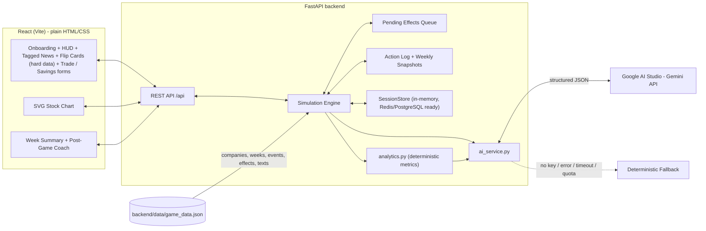
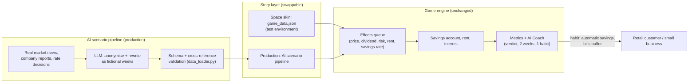

# CosmiCash (Finance Quest)

## Project Card - Collabothon 2026

**Project Name:** CosmiCash

**One-Line Summary:** A 12-week investing game with an AI teacher that helps beginners of every generation learn money skills risk-free and take a first real step with Commerzbank.

**Technology Stack:** JavaScript/React 19 + Vite (frontend), Python 3 + FastAPI + Pydantic (backend), Google Gemini API via the google-genai SDK (AI coach, advisor, teacher), browser Web Speech API (read aloud), HTML canvas and CSS (pixel art, animations). Runs locally on Windows/macOS/Linux, no cloud database.

**Source Code Repository:** https://github.com/LateMigo/Collabothon-2026

### Project Overview

**THE PROBLEM**
Many people know a little about money but still don't act: financial products feel complex, and classic courses are long and disconnected from real decisions. Beginners - teenagers, working adults and seniors - hesitate to take the first step, so they miss out on saving, emergency funds and smart investing.

**YOUR SOLUTION**
CosmiCash turns financial learning into a 12-week game in a fictional space economy. Players invest, save, pay rent and handle surprise bills while news moves prices - sometimes only weeks later, like a real market. Google Gemini explains every step at the player's level, reviews the reasons behind their decisions, and every season ends with a bridge to real life: a "What if?" replay, a personal budget plan and three Commerzbank next steps. A deliberately fallible AI advisor teaches critical thinking instead of blind trust.

**THE WORKING PROTOTYPE**
Everything below is implemented and working: a guided tour; companies with hard data, dividends and bankruptcy risk; a newspaper with real, delayed and "noise" headlines plus an old-news board; savings account, term deposits and bonds; rent and surprise bills; buy/sell with a decision journal; an AI advisor and company research; Berg, the AI teacher (3 reading levels, read aloud); weekly AI lesson and quiz; one-minute lessons with smart nudges; final AI review, "What if?" chart, real-life budget planner, Commerzbank next steps, friend challenges and a live KPI view for the bank (`/#bank`).

**BEHIND THE BUILD**
A FastAPI backend runs a deterministic, seeded game engine driven by a scenario file (companies, weekly events with delayed effects); the React frontend only sees public information. All AI features go through one service that sends structured JSON to Gemini and validates the answer against Pydantic schemas; if the key, network or quota fails, an offline generator answers instead, so the game always works. Built on React, Vite, FastAPI, Pydantic and the google-genai SDK; the game engine, scenario, AI prompts, pixel art and all features were created during the hackathon.

**CHALLENGES AND DISCOVERIES**
Keeping AI answers reliable: structured output with schema validation and fallbacks. Gemini's per-minute quota: automatic cooldown to offline mode. Game balance: full-season simulations revealed surprise bills that were too high and a replay strategy that ran out of rent money - both fixed. Hackathon feedback taught us to put the business case and beginners first.

**RESULTS AND NEXT STEPS**
A complete, playable learning mission. Validated with automated full-season simulations (9 play styles, all endpoints, all 82 scripted effects firing correctly) and manual tests of every AI feature on the live Gemini API. Most proud of: the "What if?" replay and the AI review of the player's reasoning. Limitations: in-memory sessions and KPIs, English only, example bank offers. Next: integration into the Commerzbank app with real product links, a school/class mode, more languages and scenarios.

### Answers to the Challenge Card
- **Engaging, relevant, actionable:** real consequences in a game, short AI explanations and quizzes, and a real budget plan plus Commerzbank next steps at the end.
- **Confidence to take the first step:** risk-free practice, feedback on reasoning, a "What if?" replay and a concrete plan for next month.
- **Target learner and objective:** beginners of every generation; understand market lag, risk, diversification, emergency funds, savings, bonds and budgeting.
- **Fit with the theme:** three AI reading levels, read-aloud, a gentle start and life-stage scenarios.

---

## About the game

**A turn-based investing game for every generation.**
Built for **Collabothon 2026 - Commerzbank Challenge: Finance Quest**, theme **"Innovations for all generations"**.

You start with **$3,000** and two fictional companies, and a new company joins the exchange **every 2 weeks** (Weeks 3, 5, 7 and 9 - 6 in total) during a **12-week season** (about 3 months). Every week brings new headlines in *The Galactic Ledger* - the more companies on the exchange, the more stories (from 3 a week at the start to 6 a week from Week 7). Some move prices immediately, some only weeks later, and some are just noise. You buy and sell shares, check each company's hard data (cash, debt, profit margin), collect dividends on each company's own payout calendar, park money in a safe **savings account** that pays interest, lend it through **bonds and term deposits** for a fixed rate, pay rent every four weeks and try not to back a company that is heading for bankruptcy. When the season ends, an AI coach acting as an **inspector** stamps your file (APPROVED or REJECTED), points to the two weeks that decided your season and gives you one money habit to start in real life.

The universe is entirely made up: the companies, countries, people, events and the dollar ($) are fictional. Players can experiment and lose money without any real-world consequences.

---

## Why it fits "Innovations for all generations"

| Design choice | What it means for players |
| --- | --- |
| **Universal design, no age profiles** | The game never asks for your age. The same clear interface works for teenagers, parents and grandparents. There is no timer: every week waits until you press *End Week*. |
| **Plain-language AI** | Gemini is told to write short sentences and to explain every finance word it uses. Each week has a 2-minute lesson with a small glossary called the "jargon corner". |
| **One-sentence explanations** | A **[?]** next to *Dividend/share*, *Bankruptcy risk*, *Cash*, *Debt*, *Profit margin* and *Interest* explains the term in one plain sentence ("the chance that this company runs out of money - you could lose 100% of what you put in"). |
| **Information without overload** | The advisor shows his reasoning as a short cause-and-effect chain, and each company card has hard data and one-line explanations. Which company a headline is about is left for the player to work out - that is part of the game. |
| **Real-life money mechanics** | Rent and living costs, a savings account with interest, dividends, bankruptcy risk and "market lag" are the lessons that carry over to real life. |
| **Safe to fail** | A fictional universe and a scripted scenario. Running out of cash is part of the lesson, and there are no real consequences. |

---

## Challenge questions - our answers

**"Will a 60-year-old want to play a game about space kebabs?" (All generations)**
The sci-fi setting is a deliberate psychological choice (gamification). Fictional companies remove the fear of the "real" stock market and any bias towards brands people already know or dislike. There is no timer, every finance word has a one-sentence [?] explanation, and the same interface is used by a 20-year-old and a 65-year-old - nobody is put in an "age group".

**"How do you get from here to a real bank?" (How to get there)**
The game engine (FastAPI + React) is 100% separated from the story layer. The engine only knows *effects* (`stock_price`, `dividend`, `bankruptcy_risk`, `rent`, `savings_rate`), *delays* and *hard data*; every company, headline and text lives in one validated JSON file. The space "skin" is our test environment. In production, an AI pipeline turns real market news and company reports into new, anonymised educational weeks in the same JSON format - for retail customers (rent, savings, investing) or for small businesses (cash flow). See [How to get there](#how-to-get-there-from-game-to-bank).

**"Where are the financial services?"**
The game is not only about shares. The **Commerzbank Savings** account is a safe bank product: no fees, no risk, a small weekly interest, and it pays the rent automatically when cash runs short - exactly what an emergency fund does. When the central bank raises rates in Week 9, the savings rate rises a week later, so players see how news reaches their own bank account. The end-of-game coach recommends one concrete **banking habit** (for example an automatic transfer to savings on payday, or a bills buffer of one month's rent).

The **bond desk** adds the next bank products: **term deposits** (2, 4 or 8 weeks, a better rate than savings, but the interest is lost if you leave early) and **bonds** - Valdoria Treasury bonds that pay back halfway through the season (Week 6) or at its very end (Week 12), and company bonds from Fabric of Keramzyt, Howl Starships and Laser Dzida Works with higher rates and a real **default risk**: when the issuer goes bankrupt, the bond pays back only a small part. Different rates, terms and risks make different tactics possible - and locked money can't pay the rent until it pays back.

---

## Business case for Commerzbank

**How does Commerzbank benefit?** CosmiCash is a free, fun first contact with money for beginners - and every season ends with a bridge to real banking:

1. **Acquisition.** A game reaches people before they choose a bank. *Challenge a friend* links (same seed = same season, one results board) bring new players at no cost.
2. **Conversion.** The final screen shows **"Your next 3 money steps"**: Commerzbank products picked from how the player actually played (ran short on rent -> savings account as an emergency fund; everything in one company -> fund savings plan; plus current account + app, an automatic savings transfer or an advisor meeting). Every reason quotes the player's own numbers.
3. **Relationship.** Throughout the game, *Commerzbank Savings* is the safe harbour that pays the rent when cash runs short - trust built before the first real euro.
4. **Measurable.** `/#bank` opens a live KPI view: players -> finished seasons -> saw the offers -> clicked one, plus quiz accuracy, lessons completed, questions to Berg and challenge links (`GET /api/kpi`, in memory for the demo).

**Why CosmiCash and not another finance app?** News moves prices *with a delay* (market lag), the AI advisor is deliberately wrong 3 times in 10 (critical thinking instead of blind trust), Berg explains any money word with Gemini but never picks shares, surprise bills (a cracked phone, a wedding gift, the dentist) show why an emergency fund matters, and the fictional universe means no real investment advice.

**Learning for beginners:** a one-question quiz after every week (knowledge points), 8 one-minute *Learn* lessons (budget, emergency fund, compound interest, current vs savings account, shares and risk, diversification, bonds, borrowing), a guided tour in Week 1, and the bond desk that unlocks only in Week 3.

## Look & feel

The game is styled as **Booth 7 of a shabby Galactic Exchange**: you sit at an olive-steel desk inside a space station, with space visible through the booth window. Each week's news arrives as a newspaper, *The Galactic Ledger*. Companies are paper dossiers with paperclips, and prices glow on amber CRT screens. Every outcome is rubber-stamped: trade orders get **APPROVED**, delayed effects **EFFECT FROM WEEK 1**, rumors **JUST NOISE**, and the weekly report and final performance review end with a verdict stamp. The illustrations are original and deliberately crude, as if drawn with a mouse. The fonts are Pixelify Sans, Courier Prime, VT323 and Black Ops One.

## Features

### MVP (implemented)

- **Delayed-effects queue (market lag).** Each news effect has a `delay_weeks` value. Effects with a delay of `0` hit prices in the same week. The rest wait in `pending_effects` until their `trigger_week`. The week summary marks them clearly with badges such as **"Effect from Week 1"**.
- **5 effect types.** `stock_price`, `dividend`, `rent`, `bankruptcy_risk` and `savings_rate`. Each one is either a percentage or a flat change, and it can target a single company, a whole industry or everything (`global`).
- **Server-side secrecy.** During a turn the API sends only each headline's `title` and `description`. Fields such as `is_noise`, `effects` and `delay_weeks` are never sent, so players have to work out cause and effect themselves.
- **SVG stock chart** built in plain React with no chart library. It has a legend you can click to highlight one company, a $ price / % change toggle, week markers, a "coming weeks" zone, tooltips on hover and a data table that screen readers can read.
- **3D flip company cards** made with CSS only. The front shows the price, % change, the dividend with its payout calendar ("every 4 weeks · next in Week 8"), a bankruptcy-risk gauge from *safe* to the red *bankrupt at 100%* line (Low, Elevated or Critical), the shares you hold and a line of **fine print** (for example "all spears are built in one single factory" or "price changes reach the menu weeks later") that rewards reading before you press *Buy / Sell*. The back shows the **hard data**: cash, debt and profit margin with trend arrows, published every week (`reports` in `game_data.json`); it scrolls inside the card, so the front alone decides the card's height. When the headlines shout "success" but debt keeps rising, the careful reader spots it first - Papers, Please style. A red dot on *Details (Flip)* marks new numbers.
- **[?] tooltips.** One plain sentence next to every finance term on the cards and in the savings panel. They open on hover, keyboard focus or tap and close with Escape.
- **Savings account (Commerzbank Savings).** Deposit and withdraw at any time, with no fee and no risk. Savings earn `savings_weekly_rate` (0.3%) interest at the end of every week. On rent day cash pays first and the savings cover the rest automatically. The Week 9 central-bank rate rise lifts the savings rate to 0.5% a week later (a `savings_rate` effect).
- **Bonds & term deposits (`fixed_income` in `game_data.json`).** Each product has a `weekly_rate`, either a `term_weeks` (deposits: locked from the week you open it) or a fixed `maturity_week` (bonds), a sale window, a minimum, an `early_exit_fee` and - for company bonds - an `issuer_company_id` and a `recovery_rate`. Interest is simple (`principal × weekly_rate` at every close) and is paid out with the principal at maturity, before the rent is collected. Cashing out early returns `principal × (1 - early_exit_fee)` and forfeits the interest; if the issuer goes bankrupt the holding defaults and only `principal × recovery_rate` comes back.
- **Your stocks panel.** Under the newspaper: every share you own with its value, profit or loss since you bought it and the next dividend; a click opens *Buy / Sell*.
- **Buy and sell with auto-clamping.** The frontend and the backend both clamp trades: a purchase is capped at `floor(cash / price)` and a sale at the number of shares you own. You type the number of shares (or use the − / + buttons); anything above the limit is adjusted automatically, and a warning appears when a purchase would leave you short for rent.
- **New companies every 2 weeks.** The season starts with Cosmic Pizza and Fabric of Keramzyt; Galac-Kebab (Week 3), Laser Dzida Works (5), Howl Starships (7) and Łęcicki Renovations (9) list during the game (`listed_week` in `game_data.json`). A new company shows a *Just listed* stamp, appears on the chart from its listing week and can't be traded before it lists.
- **Selling fee (spread).** Selling pays the market price minus 5% (`sell_spread` in `game_data.json`), just like the buy/sell spread on a real exchange. Selling right after buying always loses money: a price has to rise about 5.3% before selling breaks even. The trade window shows the sell price, the break-even rise and your gain or loss per sale.
- **Rent and living costs.** Rent is collected when `week % 4 == 0`. The HUD shows a countdown and highlights changes, for example **Rent: $480 (+$80)**. If your cash and savings together can't cover the rent, the game ends with a liquidity loss - but first, pressing *End Week* opens a **rent alert** that shows the gap and every way to raise cash (sell shares, cash out a deposit).
- **Investing result vs. rent.** Rent is a bill, not an investment loss: the HUD, the portfolio panel, the weekly report's stamp and the final ROI all show the investing result *before* rent (`roi_pct`, `investment_change`), and rent is listed separately.
- **Dividends on a calendar.** Each company pays `dividend_per_share` every `dividend_every_weeks` weeks (Cosmic Pizza every 4, Fabric of Keramzyt every 3, Galac-Kebab and Łęcicki every 2...), like real companies. Only owners at the end of a payout week get paid. News can raise or cut a company's dividend.
- **The End Week button always sticks out** above the bottom edge; hovering it (or opening the handle) slides up a drawer that says exactly what closing the week will do.
- **Menu.** The *Menu* button in the top bar goes back to the start screen without losing the game; *Continue* picks it up again.
- **Bankruptcy.** When a company's `bankruptcy_risk` reaches 0.85 or more, its share price drops to $0 and trading in it is stopped. The game shows risk scaled to that threshold, so the player sees 100% = bankrupt.
- **Investment Advisor lifeline (Agent Vorr).** You can ask for 3 hints per game, at most 1 per week. Each hint is drawn with a seeded random number: 70% of the time it uses the real queued effects, and 30% of the time it is built on noise or a misreading. Every hint shows Vorr's reasoning as a **cause-and-effect chain** (*Cooks and couriers earn more → Restaurant wage bills go up → Cosmic Pizza keeps less profit → Share price tends to fall*), built from `cause_chain` in the scenario file. A wrong hint comes with a convincing but wrong chain, so players learn to check every step. Every hint carries the warning *"even experts make mistakes"*.
- **Week summary.** A ledger that separates the **investing result** (share prices, dividends, interest, bond defaults) from the rent, then two sections: **"What Just Hit the Market"**, which separates immediate from delayed effects, and **"Financial Recap & Market Lag Lesson"**, which shows the company table (how many shares you own, price, % change and the bankruptcy risk now), dividends, bond payouts, rent, the headlines revealed as noise and the AI micro-lesson.
- **End-of-game Move Analysis & Financial Coaching (Inspector mode).** A stamp instead of a long essay: **APPROVED** or **REJECTED** with a label such as *Prudent Strategist*, *Careful Saver* or *FOMO Victim*; the **two weeks that decided your season** (for example "In Week 3 you bought PIZA even though the higher cook wages had already been announced - in Week 4 it hit the price"); and **one habit for real life**, usually a banking habit. The full file (play style, strengths, improvements, 3–4 tips) opens on demand. The screen also shows your final net worth, ROI, dividends, savings interest, rent paid, the final chart, your trade history and a timeline of "what really happened".
- **Gemini with an automatic fallback.** If the API key is missing, the network fails, a call times out, the quota is used up or Gemini returns malformed JSON, the game quietly switches to deterministic answers and marks them `ai_source: "fallback"`.
- Keyboard support everywhere (focus trap in dialogs, skip link, visible focus ring) and support for `prefers-reduced-motion`.

### Roadmap (Day 2, extension points already in the code)

- **CEO mode.** `GameMode.CEO`, `AdvisorProposal` (CFO vs CTO) and `CEODecision` (`invest_first`, `invest_second`, `invest_both`, `invest_none`). Stub methods exist in `game_engine.py` and `POST /api/sessions/{id}/ceo/decision` (currently returns `501`). The onboarding screen shows the mode as *Coming Soon (Phase 2)*.
- **More instruments.** `InstrumentType` already includes `LOAN`, `TAX` and `BUDGET_ALLOCATION`, and there is an `InstrumentPosition` model. The game has shares, the savings account, term deposits and bonds; a small loan would be the next bank product.
- **Scenario recommender.** The abstract `ScenarioRecommender.recommend_scenario(risk_score, past_roi)` currently returns the default scenario.
- **Persistent storage.** The `SessionStore` interface can be implemented with Redis or PostgreSQL. The in-memory store already saves sessions as serialized JSON, the same way a network store would.

---

## Architecture



### Layers

| Layer | File | Responsibility |
| --- | --- | --- |
| Data | `backend/data/game_data.json` | The whole fictional universe: 6 companies (with the week each one lists, hard data and fine print), industries, 12 weeks of events with cause chains, weekly hard-data reports, noise explanations, the savings rate and every fallback text. **The engine contains no company or event names.** |
| Contract | `app/models/schemas.py` | Pydantic v2 models for the scenario file, session state, the public API, AI inputs and outputs, and the Day-2 types. |
| Loading | `app/services/data_loader.py` | Validates `game_data.json` when the app starts: unknown targets, delayed effects that would land after the last week, missing texts. Then it indexes the data. |
| Engine | `app/services/game_engine.py` | Turn processing, the effects queue, trades, advisor, settlements, game over and the final report. |
| Analytics | `app/services/analytics.py` | Explainable metrics about the player, used as grounding for Gemini and as the offline coach. |
| AI | `app/services/ai_service.py` | Gemini calls (`google-genai`, JSON output checked against a schema) and the fallback generators. |
| Storage | `app/services/session_store.py` | The `SessionStore` interface and the `InMemorySessionStore` implementation, with per-session locks. |
| API | `app/api/routes.py`, `app/main.py` | REST endpoints, CORS for `http://localhost:5173`, and mapping of domain errors to HTTP responses. |

### How to get there: from game to bank

The engine is a generic "news → delayed effects → money" simulator. Everything that makes it a space game is data, so the same engine can run real-world-inspired lessons:



1. **Today:** one hand-written, validated scenario (`game_data.json`). The validator rejects unknown targets, effects that land after the season and reports for companies that are not listed yet.
2. **Next:** an AI pipeline turns real news and reports into new anonymised weeks in the same JSON format (headline, effects with delays, cause chains, hard data). Nothing in the engine changes.
3. **In a bank:** different scenario packs for different audiences - retail customers (rent, savings, investing basics) or small businesses (cash flow, loans, late invoices) - and the coach's final habit links to a real product, such as a savings account with an automatic monthly transfer.

---

## Data flow of one turn

The player reads Week *N*'s headlines and trades at the current prices, then presses **End Week N**:

```
POST /api/sessions/{session_id}/next-week
```

The engine closes Week *N* in this exact order:

1. **Fire scheduled effects.** Every `pending_effects` item with `trigger_week == N` is applied to prices, dividends, rent or bankruptcy risk. It is recorded in `triggered_consequences` with `is_delayed: true` and its `source_week`, then removed from the queue.
2. **Process this week's news.** Effects with `delay_weeks == 0` are applied at once (`is_delayed: false`). Effects with `delay_weeks > 0` go into `pending_effects` with `source_week = N` and `trigger_week = N + delay_weeks`. *(2b: the small scripted market drift from `game_data.json` is applied.)*
3. **Rent and savings-rate update.** If a `rent` effect fired, `monthly_rent` changes immediately. `previous_monthly_rent`, `rent_delta` and the source week are stored so the HUD can show `Rent: $480 (+$80)`. A `savings_rate` effect changes the weekly interest rate the same way.
4. **Settlements, in order:**
   - **Bankruptcy check.** A company with `bankruptcy_risk >= 0.85` goes to a price of $0 and trading in it stops.
   - **Bond defaults.** Bonds of a company that just went bankrupt pay back only `principal × recovery_rate`.
   - **Dividends.** Each holding of a company whose payout week it is pays `shares × dividend_per_share` (if dividends are enabled).
   - **Savings interest.** `savings × savings_rate` is added to the savings account.
   - **Bonds & deposits.** Every active holding earns `principal × weekly_rate`; holdings that mature this week pay principal + interest into cash.
   - **`price_history`.** The current prices are appended for the chart.
   - **Rent.** When `N % 4 == 0`, `monthly_rent` is deducted (if living costs are enabled): from cash first, then automatically from savings.
   - **`weekly_snapshots`.** Cash, savings, stock value, net worth, holdings and prices are saved.
5. **AI micro-lesson.** `ai_service.generate_week_summary(...)` receives the triggered consequences (including `source_week`), the price changes, the headlines revealed as noise, rent, savings interest and dividends. It returns a 2-minute lesson about market lag.
6. **Game over?** The game ends if the final week (Week 12) has been closed (`completed`) or if cash is below zero after rent and savings (`liquidity`). Otherwise `current_week = N + 1`, the new week's hard-data reports are published (`weeks[].reports`) and the next week's headlines are returned.

### End-of-game analysis

```
GET /api/sessions/{session_id}/final-analysis
```

1. `analytics.compute_player_metrics()` replays `action_log`, `weekly_snapshots` and `consequence_log` to measure:
   - diversification and concentration
   - cash cushion before rent and any liquidity loss
   - delayed signals caught, missed, hit or dodged
   - exposure to immediate shocks
   - bankruptcy losses, exits and avoidances
   - trades that followed noise
   - advisor hints followed
   - ROI
   - purchases made *after* a warning headline was already out (`bought_week`), savings interest and rent covered by savings
2. `ai_service.generate_final_analysis()` sends the full action log, the snapshots, the revealed market timeline and those metrics to Gemini. Gemini returns a structured `MoveAnalysis`: the inspector's `verdict` (approved, title, reason), exactly two `key_moments` (week, mistake or win, what happened), one `real_life_habit`, plus play style, strengths, improvements and 3–4 actionable tips. Running out of cash is always stamped REJECTED.
3. If Gemini is unavailable, the **Smart Offline Analysis** builds the same structure from the metrics and the templates in `game_data.json` (`verdicts`, `habits`, `insights`): the costliest mistakes become the two key weeks, and the habit is picked from the player's biggest weakness.
4. The result is cached in the session.

---

## REST API

| Method | Endpoint | Purpose |
| --- | --- | --- |
| GET | `/api/health` | Status and AI mode (`gemini` / `fallback`) |
| GET | `/api/scenario` | Scenario preview for onboarding |
| POST | `/api/sessions` | Start a game: `{ game_mode, modifiers: { enable_dividends, enable_living_costs }, seed? }` |
| GET | `/api/sessions/{id}` | Current public game state |
| POST | `/api/sessions/{id}/trade` | `{ company_id, action: "buy" \| "sell", shares }` (auto-clamped) |
| POST | `/api/sessions/{id}/savings` | `{ action: "deposit" \| "withdraw", amount }` (auto-clamped, no fee) |
| POST | `/api/sessions/{id}/fixed-income` | `{ action: "buy", product_id, amount }` or `{ action: "close", holding_id }` (cash out early) |
| POST | `/api/sessions/{id}/advisor` | Use one advisor hint |
| POST | `/api/sessions/{id}/next-week` | Close the week; returns `{ summary, state }` |
| GET | `/api/sessions/{id}/final-analysis` | End-of-game stats and coaching |
| POST | `/api/sessions/{id}/ceo/decision` | DAY-2 HOOK (returns `501`) |
| GET | `/api/recommendations/scenario` | DAY-2 HOOK (returns the default scenario) |

Interactive docs: http://localhost:8000/docs

---

## Run it locally

**Requirements:** Python 3.11+ and Node.js 18+.

### Quick start on Windows (two double-clicks)

1. **`setup.bat`**: run once after cloning. It checks for Python 3.11+ and Node.js, creates `backend/.venv`, installs the backend and frontend packages, and creates `backend/.env` from the example.
2. **`start.bat`**: run every time you want to play. It starts the backend on port **8000** and the frontend on port **5173** in two windows, waits until both are ready and opens http://localhost:5173 in your browser. Servers that are already running are reused.

Keep the two server windows open while you play; close them to stop the game.

The manual steps below do the same thing on any operating system.

### 1. Backend (FastAPI)

```bash
cd backend
python -m venv .venv
# Windows:
.venv\Scripts\activate
# macOS / Linux:
source .venv/bin/activate

pip install -r requirements.txt
cp .env.example .env          # Windows: copy .env.example .env
# optional: paste your key from https://aistudio.google.com/apikey into GEMINI_API_KEY

uvicorn app.main:app --reload --port 8000
```

### 2. Frontend (React + Vite)

```bash
cd frontend
npm install
npm run dev
```

Open **http://localhost:5173**.

### Gemini model settings (`backend/.env`)

| Variable | Default | Meaning |
| --- | --- | --- |
| `GEMINI_MODEL` | `gemini-3.5-flash-lite` | Main model. Older `gemini-2.5-flash` is no longer available to new API keys. |
| `GEMINI_FALLBACK_MODEL` | `gemini-3.1-flash-lite` | Tried when the main model is overloaded (503), times out or is not available. |
| `AI_TIMEOUT_SECONDS` | `25` | Time budget for weekly lessons and advisor hints. |
| `AI_FINAL_TIMEOUT_SECONDS` | `45` | Longer budget for the end-of-game analysis (it sends the whole game log). |

On overload (503), timeouts or malformed JSON the game alternates between the main and the fallback model until the time budget runs out; quota errors (429) pause Gemini for `AI_COOLDOWN_SECONDS`.

### Works 100% without an API key

If `GEMINI_API_KEY` is empty, the game runs entirely on the deterministic fallback AI. You still get the market-lag lessons, the advisor and the end-of-game coaching. The UI marks these as *Offline lesson*, *Offline Advisor* and *Smart Offline Analysis*. If the key is set but Gemini fails at any point (network, timeout, quota, malformed JSON), the game switches to the fallback for that answer without breaking. After a rate-limit error it skips Gemini for `AI_COOLDOWN_SECONDS`.

---

## Project structure

```
backend/
  requirements.txt
  .env.example
  data/game_data.json          # the whole scenario (12 weeks, 6 companies, all texts)
  app/
    main.py                    # FastAPI app, CORS, error mapping
    config.py                  # settings from .env
    api/routes.py              # REST endpoints
    models/schemas.py          # Pydantic models (MVP + Day-2 types)
    services/
      data_loader.py           # load + validate + index game_data.json
      session_store.py         # SessionStore interface + in-memory store
      game_engine.py           # simulation engine + effects queue
      analytics.py             # deterministic player metrics + offline coach
      ai_service.py            # Gemini + fallback (3 AI roles)
      recommender.py           # Day-2 scenario recommender skeleton
frontend/
  package.json
  vite.config.js
  index.html
  src/
    main.jsx, App.jsx
    api/client.js
    utils/format.js
    styles/main.css            # design system, stamps, flip cards, CRT chart
    components/
      Onboarding.jsx, HeroIllustration.jsx, HudBar.jsx, ScenarioPanel.jsx,
      StockChart.jsx, CompanyCard.jsx, CompanyCarousel.jsx, TradeModal.jsx,
      NewsSidebar.jsx, HoldingsPanel.jsx, AdvisorWidget.jsx, SavingsPanel.jsx, SavingsModal.jsx,
      FixedIncomePanel.jsx, FixedIncomeModal.jsx, RentAlertModal.jsx, BrandMark.jsx,
      InfoTip.jsx, WeekSummaryModal.jsx, GameOverScreen.jsx, HowToPlay.jsx, Modal.jsx
```

---

## Demo test checklist

1. **Delayed effect (Week 1 → Week 3).** In Week 1, buy PIZA after reading "Record number of students". End Weeks 1 and 2: Cosmic Pizza barely moves. End Week 3: the summary shows **"Effect from Week 1"** with a +50% rise for pizza stocks, and the chart shows the jump (about $44 to $69).
2. **Rent increase (Week 2 → Week 5).** "Parliament raises the energy excise tax" appears in Week 2; landlords pass it on when their energy contracts run out. After closing Week 5, the summary lists **"Effect from Week 2"** with monthly rent +$80, and the HUD shows **Rent: $480 (+$80)**.
3. **Rent payment (Weeks 4, 8, 12).** Closing Week 4 deducts **$400**, Week 8 **$480** and Week 12 **$520** (plus the Week 10 maintenance fee). To test the rent alert, spend almost all your cash on shares in Week 4 and press *End Week*: the alert lists the gap and what you could sell. Ending the week anyway ends the game with **Out of cash**.
4. **Immediate factory fire (Week 6).** Laser Dzida Works lists in Week 5; hold DZDA when Week 6 closes. The summary shows two **Immediate Effect** entries (share price −60% and bankruptcy risk +20 pts). The card's risk meter goes to *Elevated*, then *Critical* in Week 9, and Laser Dzida Works goes bankrupt when Week 9 closes.
5. **Top panel.** Press **▴ Hide** in the top-right corner: the top panel disappears and only a small **▾ Show panel** tab stays (it flashes red with a rent alert if you are short of cash). The choice is kept after a page refresh.
6. **Personal move analysis.** Finish Week 12, then check **Move Analysis & Financial Coaching**. The inspector's stamp (APPROVED / REJECTED) comes with a label, two key weeks and one real-life habit; *Open the full inspector's file* shows strengths and improvements that quote your actual trades (week, ticker, shares) and 3–4 tip cards. The badge reads *AI Coach · Gemini* when a key is set and *Smart Offline Analysis* when it isn't. To see the "bought into bad news" moment, buy PIZA in Week 3 (after the wage headline).
7. **Tooltips.** Hover or tap the **[?]** next to *Dividend* or *Bankruptcy risk* on a card.
8. **Hard data.** In Week 4 Cosmic Pizza's card gets a red dot: flip it - the profit margin already dropped (new wages), while the share price only reacts when Week 4 closes. A careful reader can act first. Laser Dzida Works (Week 5) looks great in the news, but its debt is $46M and cash keeps falling until the bankruptcy in Week 9.
9. **Savings vault.** Deposit $1,000 in Week 1: the weekly report shows *Savings interest +$3.00*. Keep little cash before a rent week - the rent is paid automatically from savings. After the Week 9 rate rise, the savings rate goes from 0.3% to 0.5% a week when Week 10 closes.
