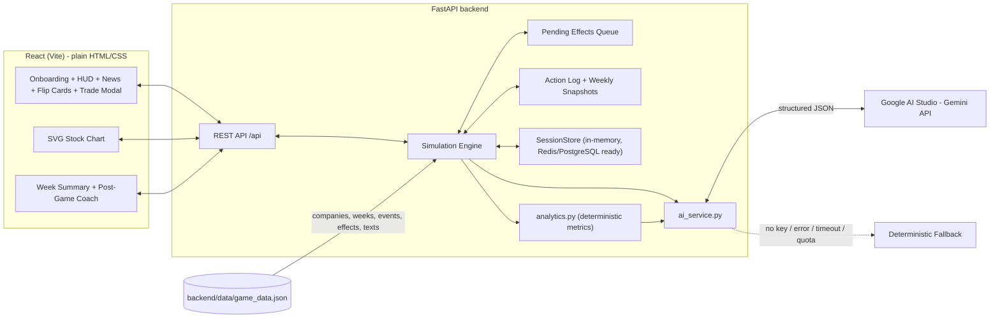

# CosmiCash

**A turn-based investing game for every generation.**
Built for the hackathon theme **"Innovations for all generations"**.

You start with **$3,000** and two fictional companies, and a new company joins the exchange **every 2 weeks** (Weeks 3, 5, 7 and 9 - 6 in total) during a **12-week season** (about 3 months). Every week brings new headlines. Some move prices immediately, some only weeks later, and some are just noise. You buy and sell shares, collect dividends, pay rent every four weeks and try not to back a company that is heading for bankruptcy. When the season ends, an AI coach looks at every move you made and explains what worked, what to change and which money habits to keep.

The universe is entirely made up: the companies, countries, people, events and the dollar ($) are fictional. Players can experiment and lose money without any real-world consequences.

---

## Why it fits "Innovations for all generations"

| Design choice | What it means for players |
| --- | --- |
| **Universal design, no age profiles** | The game never asks for your age. The same clear interface works for teenagers, parents and grandparents. |
| **Plain-language AI** | Gemini is told to write short sentences and to explain every finance word it uses. Each week has a 2-minute lesson with a small glossary called the "jargon corner". |
| **Real-life money mechanics** | Rent and living costs, dividends, bankruptcy risk and "market lag" are the lessons that carry over to real life. |
| **Safe to fail** | A fictional universe and a scripted scenario. Running out of cash is part of the lesson, and there are no real consequences. |

---

## Look & feel

The game is styled as **Booth 7 of a shabby Galactic Exchange**: you sit at an olive-steel desk inside a space station, with space visible through the booth window. Each week's news arrives as a newspaper, *The Galactic Ledger*. Companies are paper dossiers with paperclips, and prices glow on amber CRT screens. Every outcome is rubber-stamped: trade orders get **APPROVED**, delayed effects **EFFECT FROM WEEK 1**, rumors **JUST NOISE**, and the weekly report and final performance review end with a verdict stamp. The illustrations are original and deliberately crude, as if drawn with a mouse. The fonts are Pixelify Sans, Courier Prime, VT323 and Black Ops One.

## Features

### MVP (implemented)

- **Delayed-effects queue (market lag).** Each news effect has a `delay_weeks` value. Effects with a delay of `0` hit prices in the same week. The rest wait in `pending_effects` until their `trigger_week`. The week summary marks them clearly with badges such as **"Effect from Week 1"**.
- **4 effect types.** `stock_price`, `dividend`, `rent` and `bankruptcy_risk`. Each one is either a percentage or a flat change, and it can target a single company, a whole industry or everything (`global`).
- **Server-side secrecy.** During a turn the API sends only each headline's `title` and `description`. Fields such as `is_noise`, `effects` and `delay_weeks` are never sent, so players have to work out cause and effect themselves.
- **SVG stock chart** built in plain React with no chart library. It has a legend you can click to highlight one company, a $ price / % change toggle, week markers, a "coming weeks" zone, tooltips on hover and a data table that screen readers can read.
- **3D flip company cards** made with CSS only. The front shows the price, % change, dividend per share, bankruptcy risk (Low, Elevated or Critical) and the shares you hold. The back shows the country, the owner, the company's condition and its latest news.
- **Buy and sell with auto-clamping.** The frontend and the backend both clamp trades: a purchase is capped at `floor(cash / price)` and a sale at the number of shares you own. You type the number of shares (or use the − / + buttons); anything above the limit is adjusted automatically, and a warning appears when a purchase would leave you short for rent.
- **New companies every 2 weeks.** The season starts with Sizzle & Co. and Voltara Power; MediPulse Labs (Week 3), PixelNest (5), Orbitra Freight (7) and Vaultline Bank (9) list during the game (`listed_week` in `game_data.json`). A new company shows a *Just listed* stamp, appears on the chart from its listing week and can't be traded before it lists.
- **Selling fee (spread).** Selling pays the market price minus 5% (`sell_spread` in `game_data.json`), just like the buy/sell spread on a real exchange. Selling right after buying always loses money: a price has to rise about 5.3% before selling breaks even. The trade window shows the sell price, the break-even rise and your gain or loss per sale.
- **Rent and living costs.** Rent is collected when `week % 4 == 0`. The HUD shows a countdown and highlights changes, for example **Rent: $480 (+$80)**. If your cash falls below zero after paying rent, the game ends with a liquidity loss.
- **Dividends.** At the end of every week you receive `shares × dividend_per_share`. News can raise or cut a company's dividend.
- **Bankruptcy.** When a company's `bankruptcy_risk` reaches 0.85 or more, its share price drops to $0 and trading in it is stopped.
- **Investment Advisor lifeline.** You can ask for 3 hints per game, at most 1 per week. Each hint is drawn with a seeded random number: 70% of the time it uses the real queued effects, and 30% of the time it is built on noise or a misreading. Every hint carries the warning *"even experts make mistakes"*.
- **Week summary.** Two sections: **"What Just Hit the Market"**, which separates immediate from delayed effects, and **"Financial Recap & Market Lag Lesson"**, which shows the price table, dividends, rent, the headlines revealed as noise and the AI micro-lesson.
- **End-of-game Move Analysis & Financial Coaching.** It shows your playing style, strengths and improvements that refer to your actual trades, 3–4 practical tips, your final net worth, ROI, dividends, rent paid, the final chart, your trade history and a timeline of "what really happened".
- **Gemini with an automatic fallback.** If the API key is missing, the network fails, a call times out, the quota is used up or Gemini returns malformed JSON, the game quietly switches to deterministic answers and marks them `ai_source: "fallback"`.
- Keyboard support everywhere (focus trap in dialogs, skip link, visible focus ring) and support for `prefers-reduced-motion`.

### Roadmap (Day 2, extension points already in the code)

- **CEO mode.** `GameMode.CEO`, `AdvisorProposal` (CFO vs CTO) and `CEODecision` (`invest_first`, `invest_second`, `invest_both`, `invest_none`). Stub methods exist in `game_engine.py` and `POST /api/sessions/{id}/ceo/decision` (currently returns `501`). The onboarding screen shows the mode as *Coming Soon (Phase 2)*.
- **More instruments.** `InstrumentType` already includes `BOND`, `LOAN`, `TAX` and `BUDGET_ALLOCATION`, and there is an `InstrumentPosition` model. The MVP trades `STOCK` only.
- **Scenario recommender.** The abstract `ScenarioRecommender.recommend_scenario(risk_score, past_roi)` currently returns the default scenario.
- **Persistent storage.** The `SessionStore` interface can be implemented with Redis or PostgreSQL. The in-memory store already saves sessions as serialized JSON, the same way a network store would.

---

## Architecture



### Layers

| Layer | File | Responsibility |
| --- | --- | --- |
| Data | `backend/data/game_data.json` | The whole fictional universe: 6 companies (with the week each one lists), industries, 12 weeks of events, noise explanations and every fallback text. **The engine contains no company or event names.** |
| Contract | `app/models/schemas.py` | Pydantic v2 models for the scenario file, session state, the public API, AI inputs and outputs, and the Day-2 types. |
| Loading | `app/services/data_loader.py` | Validates `game_data.json` when the app starts: unknown targets, delayed effects that would land after the last week, missing texts. Then it indexes the data. |
| Engine | `app/services/game_engine.py` | Turn processing, the effects queue, trades, advisor, settlements, game over and the final report. |
| Analytics | `app/services/analytics.py` | Explainable metrics about the player, used as grounding for Gemini and as the offline coach. |
| AI | `app/services/ai_service.py` | Gemini calls (`google-genai`, JSON output checked against a schema) and the fallback generators. |
| Storage | `app/services/session_store.py` | The `SessionStore` interface and the `InMemorySessionStore` implementation, with per-session locks. |
| API | `app/api/routes.py`, `app/main.py` | REST endpoints, CORS for `http://localhost:5173`, and mapping of domain errors to HTTP responses. |

---

## Data flow of one turn

The player reads Week *N*'s headlines and trades at the current prices, then presses **End Week N**:

```
POST /api/sessions/{session_id}/next-week
```

The engine closes Week *N* in this exact order:

1. **Fire scheduled effects.** Every `pending_effects` item with `trigger_week == N` is applied to prices, dividends, rent or bankruptcy risk. It is recorded in `triggered_consequences` with `is_delayed: true` and its `source_week`, then removed from the queue.
2. **Process this week's news.** Effects with `delay_weeks == 0` are applied at once (`is_delayed: false`). Effects with `delay_weeks > 0` go into `pending_effects` with `source_week = N` and `trigger_week = N + delay_weeks`. *(2b: the small scripted market drift from `game_data.json` is applied.)*
3. **Rent update.** If a `rent` effect fired, `monthly_rent` changes immediately. `previous_monthly_rent`, `rent_delta` and the source week are stored so the HUD can show `Rent: $480 (+$80)`.
4. **Settlements, in order:**
   - **Bankruptcy check.** A company with `bankruptcy_risk >= 0.85` goes to a price of $0 and trading in it stops.
   - **Dividends.** Each holding pays `shares × dividend_per_share` (if dividends are enabled).
   - **`price_history`.** The current prices are appended for the chart.
   - **Rent.** When `N % 4 == 0`, `monthly_rent` is deducted (if living costs are enabled).
   - **`weekly_snapshots`.** Cash, stock value, net worth, holdings and prices are saved.
5. **AI micro-lesson.** `ai_service.generate_week_summary(...)` receives the triggered consequences (including `source_week`), the price changes, the headlines revealed as noise, rent and dividends. It returns a 2-minute lesson about market lag.
6. **Game over?** The game ends if the final week (Week 12) has been closed (`completed`) or if cash is below zero after rent (`liquidity`). Otherwise `current_week = N + 1` and the next week's headlines are returned.

### End-of-game analysis

```
GET /api/sessions/{session_id}/final-analysis
```

1. `analytics.compute_player_metrics()` replays `action_log`, `weekly_snapshots` and `consequence_log` to measure:
   - diversification and concentration
   - cash cushion before rent and any liquidity loss
   - delayed signals caught, missed, hit or dodged
   - exposure to immediate shocks
   - bankruptcy losses, exits and avoidances
   - trades that followed noise
   - advisor hints followed
   - ROI
2. `ai_service.generate_final_analysis()` sends the full action log, the snapshots, the revealed market timeline and those metrics to Gemini. Gemini returns a structured `MoveAnalysis`: play style, strengths, improvements and 3–4 actionable tips.
3. If Gemini is unavailable, the **Smart Offline Analysis** builds the same structure from the metrics and the templates in `game_data.json`.
4. The result is cached in the session.

---

## REST API

| Method | Endpoint | Purpose |
| --- | --- | --- |
| GET | `/api/health` | Status and AI mode (`gemini` / `fallback`) |
| GET | `/api/scenario` | Scenario preview for onboarding |
| POST | `/api/sessions` | Start a game: `{ game_mode, modifiers: { enable_dividends, enable_living_costs }, seed? }` |
| GET | `/api/sessions/{id}` | Current public game state |
| POST | `/api/sessions/{id}/trade` | `{ company_id, action: "buy" \| "sell", shares }` (auto-clamped) |
| POST | `/api/sessions/{id}/advisor` | Use one advisor hint |
| POST | `/api/sessions/{id}/next-week` | Close the week; returns `{ summary, state }` |
| GET | `/api/sessions/{id}/final-analysis` | End-of-game stats and coaching |
| POST | `/api/sessions/{id}/ceo/decision` | DAY-2 HOOK (returns `501`) |
| GET | `/api/recommendations/scenario` | DAY-2 HOOK (returns the default scenario) |

Interactive docs: http://localhost:8000/docs

---

## Run it locally

**Requirements:** Python 3.11+ and Node.js 18+.

### Quick start on Windows (two double-clicks)

1. **`setup.bat`**: run once after cloning. It checks for Python 3.11+ and Node.js, creates `backend/.venv`, installs the backend and frontend packages, and creates `backend/.env` from the example.
2. **`start.bat`**: run every time you want to play. It starts the backend on port **8000** and the frontend on port **5173** in two windows, waits until both are ready and opens http://localhost:5173 in your browser. Servers that are already running are reused.

Keep the two server windows open while you play; close them to stop the game.

The manual steps below do the same thing on any operating system.

### 1. Backend (FastAPI)

```bash
cd backend
python -m venv .venv
# Windows:
.venv\Scripts\activate
# macOS / Linux:
source .venv/bin/activate

pip install -r requirements.txt
cp .env.example .env          # Windows: copy .env.example .env
# optional: paste your key from https://aistudio.google.com/apikey into GEMINI_API_KEY

uvicorn app.main:app --reload --port 8000
```

### 2. Frontend (React + Vite)

```bash
cd frontend
npm install
npm run dev
```

Open **http://localhost:5173**.

### Gemini model settings (`backend/.env`)

| Variable | Default | Meaning |
| --- | --- | --- |
| `GEMINI_MODEL` | `gemini-3.5-flash-lite` | Main model. Older `gemini-2.5-flash` is no longer available to new API keys. |
| `GEMINI_FALLBACK_MODEL` | `gemini-3.1-flash-lite` | Tried when the main model is overloaded (503), times out or is not available. |
| `AI_TIMEOUT_SECONDS` | `25` | Time budget for weekly lessons and advisor hints. |
| `AI_FINAL_TIMEOUT_SECONDS` | `45` | Longer budget for the end-of-game analysis (it sends the whole game log). |

On overload (503), timeouts or malformed JSON the game alternates between the main and the fallback model until the time budget runs out; quota errors (429) pause Gemini for `AI_COOLDOWN_SECONDS`.

### Works 100% without an API key

If `GEMINI_API_KEY` is empty, the game runs entirely on the deterministic fallback AI. You still get the market-lag lessons, the advisor and the end-of-game coaching. The UI marks these as *Offline lesson*, *Offline Advisor* and *Smart Offline Analysis*. If the key is set but Gemini fails at any point (network, timeout, quota, malformed JSON), the game switches to the fallback for that answer without breaking. After a rate-limit error it skips Gemini for `AI_COOLDOWN_SECONDS`.

---

## Project structure

```
backend/
  requirements.txt
  .env.example
  data/game_data.json          # the whole scenario (12 weeks, 6 companies, all texts)
  app/
    main.py                    # FastAPI app, CORS, error mapping
    config.py                  # settings from .env
    api/routes.py              # REST endpoints
    models/schemas.py          # Pydantic models (MVP + Day-2 types)
    services/
      data_loader.py           # load + validate + index game_data.json
      session_store.py         # SessionStore interface + in-memory store
      game_engine.py           # simulation engine + effects queue
      analytics.py             # deterministic player metrics + offline coach
      ai_service.py            # Gemini + fallback (3 AI roles)
      recommender.py           # Day-2 scenario recommender skeleton
frontend/
  package.json
  vite.config.js
  index.html
  src/
    main.jsx, App.jsx
    api/client.js
    utils/format.js
    styles/main.css            # design system, stamps, flip cards, CRT chart
    components/
      Onboarding.jsx, HeroIllustration.jsx, HudBar.jsx, ScenarioPanel.jsx,
      StockChart.jsx, CompanyCard.jsx, TradeModal.jsx, NewsSidebar.jsx,
      AdvisorWidget.jsx, WeekSummaryModal.jsx, GameOverScreen.jsx,
      HowToPlay.jsx, Modal.jsx
```

---

## Demo test checklist

1. **Delayed effect (Week 1 → Week 3).** In Week 1, buy SZZL after reading "Record harvest". End Weeks 1 and 2: Sizzle & Co. barely moves. End Week 3: the summary shows **"Effect from Week 1"** with a +20% rise for food stocks, and the chart shows the jump.
2. **Rent increase (Week 2 → Week 3).** "Parliament raises the energy excise tax" appears in Week 2. After closing Week 3, the summary lists **"Effect from Week 2"** with monthly rent +$80, and the HUD shows **Rent: $480 (+$80)** and *Due at the end of this week!*
3. **Rent payment (Week 4).** Rent is collected in Weeks 4, 8 and 12. Closing Week 4 deducts **$480**, shown in the summary's "Your money moves" panel and in `Rent paid` on the end screen. To test the liquidity rule, start a new game, spend all your cash on shares and end four weeks without selling. The game ends with **Out of cash**.
4. **Immediate factory fire (Week 6).** PixelNest lists in Week 5; hold PIXN when Week 6 closes. The summary shows two **Immediate Effect** entries (share price −35% and bankruptcy risk +30 pts). The card's risk meter goes to *Elevated*, then *Critical* in Week 9, and PixelNest goes bankrupt when Week 9 closes.
5. **Top panel.** Press **▴ Hide** in the top-right corner: the top panel disappears and only a small **▾ Show panel** tab stays (it flashes red with a rent alert if you are short of cash). The choice is kept after a page refresh.
6. **Personal move analysis.** Finish Week 12, then check **Move Analysis & Financial Coaching**. The strengths and improvements quote your actual trades (week, ticker, shares) and there are 3–4 tip cards. The badge reads *AI Coach · Gemini* when a key is set and *Smart Offline Analysis* when it isn't.
